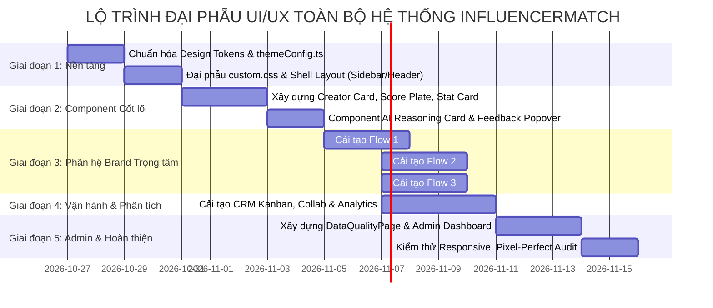

# KẾ HOẠCH ĐẠI PHẪU UI/UX TOÀN DIỆN — HỆ THỐNG INFLUENCERMATCH
> **Mục tiêu:** Chuyển đổi toàn bộ giao diện từ phong cách "Template AI / Demo chung chung" sang chuẩn **B2B MarTech Enterprise cao cấp** (chuẩn mực thiết kế tương đương Linear, Stripe, Vercel, Raycast), loại bỏ triệt để "mùi AI", tối ưu phân cấp thị giác, chuẩn hóa Design Tokens và đảm bảo tính nhất quán trên toàn bộ hệ thống Brand & Admin.  
> **Nguyên tắc cốt lõi:** *Cải tiến mạnh mẽ phần nhìn và tương tác nhưng bảo toàn tuyệt đối toàn bộ logic nghiệp vụ, API services, routing và state management đang hoạt động (Preserve Existing Functionality).*  
> **Ngày lập kế hoạch:** 26/10/2026  
> **Phiên bản:** 2.0 Enterprise Revamp Blueprint  

---

## MỤC LỤC
1. [Bản đối chiếu Phong cách: Trước vs Sau cải tạo](#1-bản-đối-chiếu-phong-cách-trước-vs-sau-cải-tạo)
2. [Hệ thống Design Tokens & Core Variables Toàn Cục](#2-hệ-thống-design-tokens--core-variables-toàn-cục)
3. [Kế hoạch cải tạo chi tiết cho 11 Phân hệ (Toàn bộ Ứng dụng)](#3-kế-hoạch-cải-tạo-chi-tiết-cho-11-phân-hệ-toàn-bộ-ứng-dụng)
   - [Phân hệ 1: Khung Layout & Hệ thống Điều hướng (Brand & Admin Shell)](#phân-hệ-1-khung-layout--hệ-thống-điều-hướng-brand--admin-shell)
   - [Phân hệ 2: Xác thực & Đăng nhập / Đăng ký (Auth Portal)](#phân-hệ-2-xác-thực--đăng-nhập--đăng-ký-auth-portal)
   - [Phân hệ 3: Brand Executive Dashboard (Trang tổng quan)](#phân-hệ-3-brand-executive-dashboard-trang-tổng-quan)
   - [Phân hệ 4: Campaign Management & Brief Wizard (Quản lý Chiến dịch)](#phân-hệ-4-campaign-management--brief-wizard-quản-lý-chiến-dịch)
   - [Phân hệ 5: Creator Discovery & Creator Detail (Khám phá KOC/KOL)](#phân-hệ-5-creator-discovery--creator-detail-khám-phá-kockol)
   - [Phân hệ 6: AI Recommendation & Four-Memory Engine (Đề xuất & Phản hồi AI)](#phân-hệ-6-ai-recommendation--four-memory-engine-đề-xuất--phản-hồi-ai)
   - [Phân hệ 7: Shortlist & Comparison (Giỏ chọn lọc & So sánh KOC)](#phân-hệ-7-shortlist--comparison-giỏ-chọn-lọc--so-sánh-koc)
   - [Phân hệ 8: Outreach CRM & Relationship Pipeline (Quản lý Thương lượng)](#phân-hệ-8-outreach-crm--relationship-pipeline-quản-lý-thương-lượng)
   - [Phân hệ 9: Collaboration Operations & Outcomes (Vận hành & Đánh giá)](#phân-hệ-9-collaboration-operations--outcomes-vận-hành--đánh-giá)
   - [Phân hệ 10: Performance Analytics & Campaign History (Báo cáo & Lịch sử)](#phân-hệ-10-performance-analytics--campaign-history-báo-cáo--lịch-sử)
   - [Phân hệ 11: Admin & Data Management Portal (Quản trị Dữ liệu & Hệ thống)](#phân-hệ-11-admin--data-management-portal-quản-trị-dữ-liệu--hệ-thống)
4. [Bộ Quy tắc "De-AI" & Tiêu chuẩn Chi tiết Giao diện](#4-bộ-quy-tắc-de-ai--tiêu-chuẩn-chi-tiết-giao-diện)
5. [Lộ trình Triển khai 5 Giai đoạn (Roadmap & Action Plan)](#5-lộ-trình-triển-khai-5-giai-đoạn-roadmap--action-plan)
6. [Tiêu chí Nghiệm thu Chất lượng Thiết kế (Design DoD)](#6-tiêu-chí-nghiệm-thu-chất-lượng-thiết-kế-design-dod)

---

## 1. BẢN ĐỐI CHIẾU PHONG CÁCH: TRƯỚC VS SAU CẢI TẠO

| Tiêu chí | Giao diện Hiện tại (AI Template Cliché) | Giao diện Sau Cải tạo (Enterprise MarTech) |
| :--- | :--- | :--- |
| **Bảng màu (Palette)** | Nền tím nhạt, gradient hồng/tím, viền glow tím neon, rải rác xanh/tím không kiểm soát. | **Slate Canvas** (`#F8FAFC`), Card trắng thuần (`#FFFFFF`), Viền 1px mỏng sắc nét (`#E2E8F0`). Điểm nhấn **Cobalt Deep Blue** (`#1E40AF` / `#2563EB`) và **Emerald** (`#059669`). |
| **Bo góc (Corner Radius)** | Bo góc quá tròn và lỏng lẻo (`14px - 18px`), tạo cảm giác ứng dụng đồ chơi trẻ con. | **Bo góc công thái học chuẩn mực** (`8px - 10px`). Đường nét chắc chắn, chuyên nghiệp, cấu trúc dạng lưới chuẩn B2B. |
| **Đổ bóng (Elevation)** | Bóng mờ to, đục màu tím: `0 4px 20px rgba(99,102,241,0.15)`. | **Micro-elevation sắc nét**: `0 1px 2px rgba(0,0,0,0.05)` kết hợp viền mờ 1px, tạo cảm giác thẻ phẳng cao cấp có chiều sâu vừa phải. |
| **Cách thể hiện AI** | Tràn ngập icon Robot 🤖, Tia sét ⚡, Ngôi sao ✨, Huy hiệu "AI Beta" hào nhoáng nhưng rỗng nội dung. | **Subtle & Actionable AI:** Không khoe icon AI; giá trị AI thể hiện ở **Độ chính xác dữ liệu**, **Thẻ lý do đề xuất (Reasoning)** và **Score Breakdown** minh bạch. |
| **Trình bày Số liệu** | Dùng font text thông thường, số nhảy xô lệch, format lộn xộn giữa `$` và `VNĐ`. | **Tabular Numbers (`tabular-nums`)**, phân cấp font-weight đậm dứt khoát (`700 - 800`), format tiền tệ VNĐ và số liệu mạng xã hội (4.8%, 1.2M) ngay ngắn thẳng hàng. |
| **Tương tác (Interactions)** | Hover giật nhảy `translateY(-4px)` đơn điệu, thiếu phản hồi loading/empty thực tế. | **Micro-interactions êm dịu (150ms)**: Border glow nhẹ nhàng, loading dạng skeleton mềm mại, empty-states vẽ tay tinh tế mang tính hướng dẫn. |

---

## 2. HỆ THỐNG DESIGN TOKENS & CORE VARIABLES TOÀN CỤC

Toàn bộ hệ thống sẽ được quy chuẩn về một bộ Design Tokens tập trung trong `themeConfig.ts` và `index.css`:

### 🎨 A. Bảng màu Chuẩn mực (Design Tokens)
```css
:root {
  /* Canvas & Neutral */
  --canvas-bg: #F8FAFC;            /* Slate 50: Nền tổng thể làm việc */
  --surface-bg: #FFFFFF;           /* Card, Modal, Dropdown */
  --surface-subtle: #F1F5F9;       /* Slate 100: Nền phụ, header bảng */
  --surface-hover: #F8FAFC;        /* Slate 50 hover */
  
  /* Borders */
  --border-subtle: #F1F5F9;        /* Đường kẻ phân cách phụ */
  --border-default: #E2E8F0;       /* Slate 200: Viền Card, Input, Table */
  --border-strong: #CBD5E1;        /* Slate 300: Viền khi focus/hover */
  
  /* Typography Colors */
  --text-heading: #0F172A;         /* Slate 900: Tiêu đề trang, Tên KOC */
  --text-body: #334155;            /* Slate 700: Văn bản chính, mô tả */
  --text-muted: #64748B;           /* Slate 500: Nhãn phụ, thời gian */
  --text-placeholder: #94A3B8;     /* Slate 400: Gợi ý placeholder */

  /* Brand Accents (Deep Executive Blue) */
  --brand-primary: #2563EB;        /* Blue 600: Nút chính, link, active tab */
  --brand-hover: #1D4ED8;          /* Blue 700 */
  --brand-active: #1E40AF;         /* Blue 800 */
  --brand-surface: #EFF6FF;        /* Blue 50: Nền tag active, badge */
  
  /* Semantic Status */
  --status-success: #059669;       /* Emerald 600: Hoàn thành, Điểm Match cao */
  --status-success-bg: #ECFDF5;
  --status-warning: #D97706;       /* Amber 600: Đang đàm phán, Cần duyệt */
  --status-warning-bg: #FFFBEB;
  --status-error: #DC2626;         /* Red 600: Thất bại, Từ chối */
  --status-error-bg: #FEF2F2;
  --status-info: #0284C7;          /* Sky 600: Bản nháp, Thông tin */
  --status-info-bg: #F0F9FF;

  /* Geometry & Motion */
  --radius-sm: 6px;                /* Tag, Button nhỏ */
  --radius-md: 8px;                /* Button, Input, Dropdown */
  --radius-lg: 10px;               /* Card, Table, Drawer */
  --radius-xl: 14px;               /* Modal chính, Hero banner */
  --shadow-card: 0 1px 3px 0 rgba(15, 23, 42, 0.05), 0 1px 2px -1px rgba(15, 23, 42, 0.05);
  --shadow-hover: 0 4px 12px 0 rgba(15, 23, 42, 0.08);
  --transition-fast: all 0.15s cubic-bezier(0.4, 0, 0.2, 1);
}
```

### 🔤 B. Typography Scale & Tabular Numerals
* **Tiêu đề Trang (H1):** `fontSize: 22px`, `fontWeight: 800`, `lineHeight: 1.25`, `letterSpacing: -0.025em`.
* **Tiêu đề Phân mục (H2/H3):** `fontSize: 16px - 18px`, `fontWeight: 700`.
* **Văn bản Nội dung:** `fontSize: 13.5px`, `fontWeight: 400 - 500`, `lineHeight: 1.5`.
* **Toàn bộ Số liệu (Metrics, VND, Scores):** Bắt buộc kích hoạt thuộc tính `font-variant-numeric: tabular-nums; font-feature-settings: 'tnum';` để các cột số liệu không bị lệch hàng.

---

## 3. KẾ HOẠCH CẢI TẠO CHI TIẾT CHO 11 PHÂN HỆ

---

### Phân hệ 1: Khung Layout & Hệ thống Điều hướng (Brand & Admin Shell)
*Các tệp liên quan:* `src/components/layout/AppSider.tsx`, `AppHeader.tsx`, `src/components/admin/AdminSidebar.tsx`, `AdminHeader.tsx`, `src/styles/custom.css`.

#### Vấn đề hiện tại:
- Sidebar Brand sử dụng dải gradient 4 tầng lòe loẹt, menu active có màu xanh bóng bẩy đổ bóng mờ, nhưng menu con lại có màu tím.
- Header trên cùng chưa tận dụng tối đa chiều ngang, khoảng đệm không đồng nhất giữa Brand và Admin.

#### Hành động cải tạo:
- [ ] **Sidebar Brand (`AppSider`):**
  - Đổi nền sang màu trắng thuần khiết `#FFFFFF` hoặc Slate Slate `#FBFDFF`, viền phải tinh tế `1px solid var(--border-default)`.
  - Bỏ bóng mờ tím.
  - Mục Menu đang chọn (Active Item): Nền xanh nhạt `#EFF6FF`, chữ xanh đậm `#1D4ED8`, viền trái dày 3px màu `#2563EB` (Indicator Pill).
  - Mục Menu bình thường: Màu chữ Slate 600 (`#475569`), hover êm dịu lên nền `#F8FAFC`.
  - Nhóm Menu đa tầng ("Chiến dịch" có con): Đường kẻ nhánh màu `#E2E8F0` sắc mảnh, thụt lề dứt khoát 12px.
- [ ] **Top Header (`AppHeader`):**
  - Bố cục tối giản: Trái là Breadcrumb đường dẫn trang, Phải là Selector chọn Chiến dịch hiện hành (Active Campaign Selector), Nút thông báo và Avatar người dùng.
  - Đổ bóng Header: Dùng đường viền mờ đáy `border-bottom: 1px solid var(--border-default)` thay vì box-shadow lơ lửng.
- [ ] **Admin Shell (`AdminSidebar`):**
  - Đồng bộ thiết kế với Brand Shell nhưng mang tone màu **Slate Dark Accent** (`#0F172A`) ở logo và icon để Data Manager / Admin cảm nhận rõ đây là khu vực kiểm soát hệ thống (System Control Plane).

---

### Phân hệ 2: Xác thực & Đăng nhập / Đăng ký (Auth Portal)
*Các tệp liên quan:* `src/pages/auth/LoginPage.tsx`, `RegisterPage.tsx`, `ForgotPasswordPage.tsx`, `ResetPasswordPage.tsx`, `src/components/layout/AuthLayout.tsx`.

#### Vấn đề hiện tại:
- Form đăng nhập thường dùng các card nổi lơ lửng trên nền gradient tím hồng, thiếu cảm giác trang nghiêm của một nền tảng B2B xử lý dòng tiền và hợp đồng.

#### Hành động cải tạo:
- [ ] **Layout Split-Screen Hiện đại:**
  - **Cột Trái (55%):** Khu vực Showcase thương hiệu (Art Direction): Nền Slate Navy sâu thẳm (`#0F172A`), hiển thị hình ảnh mockup chất lượng cao (hoặc trích dẫn số liệu ấn tượng: *"Hơn 10.000+ KOC đã xác thực doanh thu"*), hoa văn hình học hoặc lưới tinh tế.
  - **Cột Phải (45%):** Form đăng nhập trên nền trắng tinh giản, căn giữa hoàn hảo.
- [ ] **Form Controls:**
  - Input: Viền xám `1px solid #E2E8F0`, khi focus chuyển sang xanh `#2563EB` kèm `box-shadow: 0 0 0 3px rgba(37,99,235,0.12)`.
  - Nút Đăng nhập bằng Google: Nền trắng, viền xám, logo Google chính hãng, font-weight 600, căn giữa thanh lịch.
  - Thông báo lỗi (Error message): Hiển thị inline màu đỏ dứt khoát dưới trường nhập, không dùng alert đỏ choáng ngợp toàn màn hình.

---

### Phân hệ 3: Brand Executive Dashboard (Trang tổng quan)
*Các tệp liên quan:* `src/pages/dashboard/DashboardPage.tsx`.

#### Vấn đề hiện tại:
- Các con số thống kê nằm trong các Card trắng giống nhau, icon tròn màu mè, biểu đồ chưa thể hiện rõ thông tin cần ưu tiên hành động.

#### Hành động cải tạo:
- [ ] **Hàng KPI Cards đầu trang (Metric Strip):**
  - 4 Thẻ KPI then chốt: *Chiến dịch đang chạy*, *KOC đang tương tác*, *Tổng ngân sách đã cam kết*, *Tỷ lệ tương tác trung bình*.
  - Font số liệu lớn (`28px`, `font-weight: 800`, `tabular-nums`).
  - Huy hiệu Trend tăng giảm (`+12.5% so với tháng trước`): Tag màu xanh lá mint `#ECFDF5` với icon mũi tên nhỏ.
- [ ] **Khu vực "Việc cần xử lý ngay" (Action Required Center):**
  - Thay vì danh sách thông báo chung chung, tạo widget dạng Todo: *"3 Creator đã gửi báo giá cần duyệt"*, *"1 Chiến dịch đã cạn ngân sách"*.
  - Nút hành động nhanh (Quick Action) nằm ngay trên từng dòng.
- [ ] **Biểu đồ Hiệu suất (Performance Chart):**
  - Màu đường đồ thị: Dùng đường cong Cobalt Blue `#2563EB` sắc nét trên nền lưới Slate xám mờ; tooltip hover hiển thị đầy đủ ngày giờ và doanh số VNĐ.

---

### Phân hệ 4: Campaign Management & Brief Wizard (Quản lý Chiến dịch)
*Các tệp liên quan:* `src/pages/campaign/CreateCampaignPage.tsx`, `CampaignListPage.tsx`, `CampaignDetailPage.tsx`, `CampaignManagementPage.tsx`, `src/components/ai/AiBriefAssistant.tsx`.

#### Vấn đề hiện tại:
- Form tạo chiến dịch 3 bước dài dòng, nút "AI Brief" có popup trông như cửa sổ chat đơn giản, chưa tạo cảm giác một bộ công cụ phân tích chiến lược.

#### Hành động cải tạo:
- [ ] **Trang Tạo Chiến dịch (`CreateCampaignPage.tsx`):**
  - **Step Indicator:** Thiết kế thanh bước tiến (Step Tracker) nằm ngang tối giản, trạng thái active là số màu trắng trên nền tròn xanh `#2563EB`, bước đã qua có icon check xanh.
  - **Khung AI Brief "Command Center":**
    - Đặt ở đầu Step 1 với viền kép tinh tế và nền xám ấm nhẹ `#F8FAFC`.
    - Ô gõ Prompt to bản, placeholder gợi ý thực tế.
    - 4 Nút Chip mẫu: `[💄 Làm đẹp Gen-Z]`, `[📱 Review Công nghệ]`, `[🍲 Ẩm thực F&B]`, `[👗 Thời trang OOTD]`.
    - Khi AI phân tích: Animation thanh quét nhẹ nhàng, kết quả đổ xuống hiển thị hộp Callout giải thích `aiExplanation` rành mạch.
  - **Thanh Bottom Bar cố định (Sticky Action Footer):**
    - Bên trái: Tóm tắt nhanh tên chiến dịch & ngân sách dự kiến.
    - Bên phải: Nút `"Lưu bản nháp"` (Ghost Button) và Nút `"Tiếp tục chạy đề xuất"` (Solid Primary Button với icon `ArrowRight`).
- [ ] **Danh sách Chiến dịch (`CampaignListPage.tsx`):**
  - Bảng danh sách chuẩn Enterprise: Tên chiến dịch in đậm kèm tag trạng thái (`DRAFT` xám, `READY_FOR_DISCOVERY` xanh dương, `ACTIVE` xanh lá, `COMPLETED` tím).
  - Thanh tiến độ ngân sách dạng mini progress bar trực quan (Ví dụ: Đã tiêu 18M / 25M).
- [ ] **Chi tiết Chiến dịch (`CampaignDetailPage.tsx`):**
  - Bố cục 2 cột: Cột trái (70%) là Tiến trình & Pipeline KOC; Cột phải (30%) là Tóm tắt Brief, Ngân sách và Mục tiêu chiến dịch.

---

### Phân hệ 5: Creator Discovery & Creator Detail (Khám phá KOC/KOL)
*Các tệp liên quan:* `src/pages/creator/CreatorDiscoveryPage.tsx`, `CreatorDetailPage.tsx`.

#### Vấn đề hiện tại:
- Danh sách KOC quá nhiều thông tin hỗn độn, thẻ Creator cao và chiếm diện tích màn hình nhưng phần số liệu quan trọng lại bị nhỏ.

#### Hành động cải tạo:
- [ ] **Thanh Lọc Đa năng (Universal Filter Bar):**
  - Thiết kế Sticky ở đỉnh trang, bo góc 8px, nền trắng có viền mỏng.
  - Bộ nút chuyển nền tảng dạng Pill: Icon TikTok đen, Instagram hồng cam, YouTube đỏ với số lượng KOC hiển thị kèm theo.
  - Dropdown Niche lấy động từ `/taxonomies/niches`.
  - Switch chuyển đổi chế độ tìm kiếm: **Tìm thường (FTS)** vs **AI Ngữ nghĩa (Semantic Vector)**.
- [ ] **Thẻ Creator Kiến trúc "Index Card":**
  - **Đầu thẻ:** Avatar tròn sắc nét (48px) có border 1.5px, Tên hiển thị to đậm kèm badge tick xác thực xanh. Handle `@username` màu xám mờ.
  - **Dải chỉ số (Metrics Bar):** 3 Cột cố định ngăn cách bởi vạch xám mờ:
    * Người theo dõi (Followers: `450K`)
    * Tỷ lệ tương tác (Engagement: `5.2%`)
    * Giá ước tính (Avg Price: `₫12M`)
  - **Chân thẻ:** Nút xem chi tiết và Nút dấu `+` để thêm nhanh vào giỏ Shortlist trong 1 click.
- [ ] **Trang Chi tiết Creator (`CreatorDetailPage.tsx`):**
  - Hero Header: Ảnh cover phía sau mờ nhẹ, Avatar lớn (80px), Huy hiệu mạng xã hội liên kết (Linked Accounts: TikTok, Insta, YouTube).
  - Lưới bài đăng mẫu gần đây (`recentPosts`): Hiển thị dạng video/ảnh thumbnail tỷ lệ chuẩn 9:16 hoặc 1:1, hover hiển thị số views và likes thực tế.

---

### Phân hệ 6: AI Recommendation & Four-Memory Engine (Đề xuất & Phản hồi AI)
*Các tệp liên quan:* Thêm mới `src/components/recommendation/RecommendationCard.tsx`, tích hợp trong `CampaignManagementPage.tsx` và `CreatorDiscoveryPage.tsx`.

#### Vấn đề hiện tại:
- Hiện chưa có giao diện hiển thị Four-Memory Matching; widget AI hiện tại chỉ là popup giả lập.

#### Hành động cải tạo:
- [ ] **Màn hình Đề xuất AI Đẳng cấp:**
  - Banner đầu trang: Tóm tắt phiên đề xuất: *"Đã phân tích 1.250 KOC dựa trên Brief Chiến dịch v{contextVersion}. Tìm thấy 12 KOC có độ khớp cao nhất."*
  - Nút **"Chạy lại đề xuất"** và Nút **"Lịch sử các lần chạy (Runs)"**.
- [ ] **Tấm Thẻ Đề xuất (AI Recommendation Item Card):**
  - **Điểm Match Score (The Score Plate):** Đặt ở góc trên bên phải thẻ với font số cỡ lớn (`24px`, màu xanh lục `#059669` hoặc xanh navy `#1E40AF` viền tròn).
  - **Hover Tooltip: Score Breakdown:**
    - Thanh đo 3 bộ nhớ: *M1 - Khớp hồ sơ & ngành hàng (94%)*, *M2 - Hiệu suất tương tác (88%)*, *M4 - Lịch sử & Feedback (92%)*.
  - **Hộp Lý do Đề xuất (The Reasoning Box):**
    - Nền xám ấm `#F8FAFC`, có vạch dọc dày 3px màu xanh chủ đạo bên trái.
    - Đoạn kết luận súc tích (`reasoning.summary`).
    - 2-3 Bullet lý do cụ thể (`reasoning.reasons`): Ví dụ *"Tệp người xem 78% là nữ tại TP.HCM đúng với đối tượng mục tiêu của chiến dịch."*
  - **Bộ nút Feedback 2 chiều (Action / Rejection):**
    - Nút **"Chọn KOC này"** (Xanh lá / Solid Primary): Tự động thêm vào Shortlist và gửi `ACCEPT`.
    - Nút **"Không phù hợp"** (Ghost Gray Button): Click mở popover chọn nhanh lý do (`Giá quá cao`, `Sai tệp`, `Nội dung kém`) và ô ghi chú, gửi `REJECT` để loại trừ KOC trong tương lai.

---

### Phân hệ 7: Shortlist & Comparison (Giỏ chọn lọc & So sánh KOC)
*Các tệp liên quan:* `src/pages/creator/CreatorShortlistPage.tsx`, `src/components/discovery/AddToShortlistModal.tsx`.

#### Vấn đề hiện tại:
- Danh sách Shortlist còn mang tính liệt kê thô sơ; tính năng So sánh 2-5 KOC chưa có bảng đối chiếu chỉ số trực quan.

#### Hành động cải tạo:
- [ ] **Giao diện Shortlist Quản lý theo Chiến dịch:**
  - Gom nhóm KOC theo trạng thái tiếp cận: `Đã lưu (Saved)` ➔ `Sẵn sàng liên hệ (Ready)` ➔ `Đã liên hệ (Contacted)`.
  - Có thanh công cụ chọn nhiều (Batch Actions): "Chuyển toàn bộ sang CRM", "Gửi email hàng loạt", "Xóa khỏi Shortlist".
- [ ] **Bảng So sánh KOC Đối xứng (Comparison Matrix):**
  - Cho phép tick chọn 2 đến 5 KOC và bấm **"So sánh chuyên sâu"**.
  - Hiển thị dạng bảng đối chiếu cột:
    - Cột cố định bên trái: Tên chỉ số (Followers, Engagement, Chi phí, Đánh giá, Nền tảng chính).
    - Các cột bên phải: Hồ sơ từng KOC. Chỉ số nào tốt nhất trong nhóm được highlight badge xanh lá nổi bật (Best Value).

---

### Phân hệ 8: Outreach CRM & Relationship Pipeline (Quản lý Thương lượng)
*Các tệp liên quan:* `src/pages/crm/OutreachCrmPage.tsx`, `CampaignManagementPage.tsx` (Kanban view).

#### Vấn đề hiện tại:
- Kanban board còn cứng nhắc, khoảng cách giữa các cột chưa thông thoáng, thẻ KOC trong cột kéo thả còn thiếu thông tin thỏa thuận giá tiền.

#### Hành động cải tạo:
- [ ] **Bảng Kanban CRM Cao cấp:**
  - 5 Cột chuẩn quy trình: `TIẾP CẬN (Contacted)` ➔ `ĐANG THƯƠNG LƯỢNG (Negotiating)` ➔ `ĐÃ ĐỒNG Ý (Agreed)` ➔ `KÝ HỢP ĐỒNG (Contracted)` ➔ `TỪ CHỐI (Declined)`.
  - Header cột có badge đếm số lượng KOC và tổng ngân sách dự kiến của từng cột.
  - Thẻ KOC trong Kanban: Avatar, Tên, Nền tảng, Mức giá đề xuất vs Mức giá chốt (`agreedFee`), ghi chú bước tiếp theo (`nextAction`).
  - Hỗ trợ thao tác kéo thả mượt mà với hiệu ứng bóng mờ khi di chuột.

---

### Phân hệ 9: Collaboration Operations & Outcomes (Vận hành & Đánh giá)
*Các tệp liên quan:* `src/pages/collaboration/CollaborationPage.tsx`.

#### Vấn đề hiện tại:
- Màn hình theo dõi hợp tác và nghiệm thu bài đăng (Evidence & Outcome) còn khô khan, các link bài viết mạng xã hội chưa có preview đẹp mắt.

#### Hành động cải tạo:
- [ ] **Trung tâm Giám sát Hợp tác:**
  - Timeline tiến độ rõ ràng từng mốc: *Nhận sản phẩm trải nghiệm* ➔ *Gửi bản nháp video* ➔ *Duyệt video* ➔ *Đăng bài chính thức* ➔ *Nghiệm thu chỉ số*.
  - Thẻ bài đăng nghiệm thu (Evidence Asset): Hiển thị URL bài đăng có icon nền tảng, nút click mở trực tiếp bài viết gốc.
  - Bảng ghi nhận kết quả (Outcomes): Ô nhập số views, likes, shares, link báo cáo tự báo cáo (Self-reported metrics) kèm form đánh giá sao (1 - 5 sao) và nhận xét chất lượng làm việc của KOC.

---

### Phân hệ 10: Performance Analytics & Campaign History (Báo cáo & Lịch sử)
*Các tệp liên quan:* `src/pages/performance/PerformancePage.tsx`, `src/pages/history/CampaignHistoryPage.tsx`.

#### Vấn đề hiện tại:
- Biểu đồ và chỉ số phân tích chưa có cấu trúc phân tầng thông tin, bảng lịch sử chiến dịch trước đó còn mang tính thô ráp.

#### Hành động cải tạo:
- [ ] **Trang Báo cáo Hiệu suất (`PerformancePage.tsx`):**
  - **Thẻ Điểm số ROAS / ROI Hero:** Đặt trang trọng ở đầu trang: Doanh thu tạo ra vs Chi phí đầu tư, kèm tỷ lệ hoàn vốn thực tế.
  - **Phân bổ Nền tảng:** Biểu đồ Donut Chart thanh mảnh thể hiện tỷ trọng doanh số giữa TikTok, Instagram và YouTube.
  - Bảng xếp hạng Top KOC mang lại chuyển đổi cao nhất: Có huy hiệu Top 1, Top 2, Top 3 kèm chỉ số CPA (Cost per Acquisition) cụ thể.
- [ ] **Trang Lịch sử Chiến dịch (`CampaignHistoryPage.tsx`):**
  - Thiết kế dạng thẻ Dossier (Hồ sơ tổng kết): Mỗi chiến dịch đã qua có thẻ điểm tổng kết (Score Circle), mức độ đạt KPI (KPI Achievement Bar) và tóm tắt bài học kinh nghiệm rút ra (Lessons learned).

---

### Phân hệ 11: Admin & Data Management Portal (Quản trị Dữ liệu & Hệ thống)
*Các tệp liên quan:* `src/pages/admin/datasources/DataSourcesPage.tsx`, `CollectionJobsPage.tsx`, tạo mới `DataQualityPage.tsx`, `CreatorClaimReviewPage.tsx`, `AccountManagementPage.tsx`, `AuditLogPage.tsx`.

#### Vấn đề hiện tại:
- Màn hình Data Sources và Collection Jobs đang hiển thị dưới dạng các thẻ màu tím, thiếu tính chất kỹ thuật nghiêm túc của một Data Ops Center.
- Chưa có trang Duyệt chất lượng dữ liệu KOC (`/admin/data-quality`) cho Data Manager.

#### Hành động cải tạo:
- [ ] **Quản lý Nguồn Dữ liệu (`DataSourcesPage.tsx`):**
  - Chuyển sang phong cách **Control Panel tối giản**: Nền Slate sạch sẽ, bảng hiển thị trạng thái kết nối API (TikTok API, Instagram Graph API, YouTube Data v3).
  - Trạng thái rõ ràng: Xanh lục (Hoạt động ổn định), Vàng (Chạm ngưỡng Rate Limit), Đỏ (Lỗi kết nối / Hết hạn Token).
  - Nút kiểm tra kết nối (Ping Test) và số lượng record thu thập trong 24h qua.
- [ ] **Theo dõi Tiến trình Cào Dữ liệu (`CollectionJobsPage.tsx`):**
  - Bảng giám sát tiến trình Crawler thời gian thực: Mã Job, Nguồn, Loại tác vụ, Thời gian chạy, Tỷ lệ thành công (Success Rate %).
  - Drawer xem chi tiết Log: Giao diện nền đen Slate kiểu Terminal (`#0F172A`) với chữ xanh/trắng monospace hiển thị chính xác các dòng log crawler.
- [ ] **Trang Duyệt Chất lượng Dữ liệu (`DataQualityPage.tsx` - Mới hoàn toàn):**
  - Bảng danh sách các KOC có độ tin cậy AI dưới 70% (`dataConfidence < 0.7`).
  - Cột điểm tin cậy thể hiện qua Mini Progress Bar (chiều cao 6px, màu cam/đỏ sắc sảo).
  - Thao tác 1-Click: Nút "Duyệt nhanh" và Nút "Sửa ngách & Duyệt" giúp Data Manager thao tác hàng trăm bản ghi một cách nhanh chóng.

---

## 4. BỘ QUY TẮC "DE-AI" & TIÊU CHUẨN CHI TIẾT GIAO DIỆN

Để toàn bộ thành viên dự án và AI Assistant tuân thủ nghiêm ngặt trong quá trình viết code, áp dụng bộ quy tắc 5 KHÔNG và 5 NÊN:

### ❌ 5 ĐIỀU TUYỆT ĐỐI KHÔNG LÀM (ANTI-PATTERNS):
1. **KHÔNG dùng dải gradient tím/hồng lơ lửng** trên nền Sidebar, Card hoặc Button chính.
2. **KHÔNG nhồi nhét icon Robot 🤖, Tia sét ⚡, Lấp lánh ✨** ở mọi ngóc ngách nếu không có ý nghĩa chức năng cụ thể.
3. **KHÔNG để góc bo quá lớn (> 14px)** cho các thẻ bảng, form input hoặc container nghiệp vụ dữ liệu.
4. **KHÔNG dùng hiệu ứng hover nhảy xóc (`translateY(-4px)`)** gây mỏi mắt và mất tập trung khi lướt bảng danh sách KOC.
5. **KHÔNG dùng số tiền không có đơn vị rõ ràng** (tuyệt đối không trộn lẫn giữa `$500` và `25.000.000 VNĐ` trong cùng một luồng chiến dịch).

###  5 TIÊU CHUẨN BẮT BUỘC PHẢI CÓ (STANDARDS):
1. **Dữ liệu số thẳng hàng:** Bật `tabular-nums` cho mọi con số tài chính, điểm số và chỉ số mạng xã hội.
2. **Visual Hierarchy 3 cấp độ:** Luôn làm rõ đâu là Tiêu đề chính (Bold 800), đâu là Dữ liệu đo lường (Bold 700), và đâu là Nhãn giải thích (Regular 400).
3. **Reasoning-Driven:** Luôn đi kèm lời giải thích ngắn gọn, thuyết phục bên cạnh mỗi điểm số đề xuất của AI.
4. **Trạng thái trọn vẹn (State Coverage):** Mọi màn hình và bảng biểu đều phải có đủ 4 trạng thái: *Đang tải (Skeleton)*, *Rỗng (Empty State có hướng dẫn hành động)*, *Lỗi (Error có nút Retry)*, và *Bình thường (Populated)*.
5. **Micro-interactions tinh tế:** Thời gian chuyển đổi (transition) dao động từ `150ms` đến `200ms`, dùng hàm chuyển động `cubic-bezier(0.4, 0, 0.2, 1)`.

---

## 5. LỘ TRÌNH TRIỂN KHAI 5 GIAI ĐOẠN (ROADMAP & ACTION PLAN)



### Chi tiết các bước thực hiện:
* **Giai đoạn 1 (Nền tảng & Shell):**
  - Cập nhật [src/theme/themeConfig.ts](file:///d:/INFLUENCERMATCH/src/theme/themeConfig.ts) với token màu Slate/Cobalt, bo góc 8px.
  - Cập nhật [src/styles/custom.css](file:///d:/INFLUENCERMATCH/src/styles/custom.css), làm sạch thanh Sidebar Brand và Top Header.
* **Giai đoạn 2 (Thư viện Component chuẩn):**
  - Xây dựng các component dùng chung: `ScorePlate`, `ReasoningCard`, `CreatorIndexCard`, `KpiMetricBox`.
* **Giai đoạn 3 (Brand Core Screens - Flow 1, 2, 3):**
  - Đại phẫu [CreateCampaignPage.tsx](file:///d:/INFLUENCERMATCH/src/pages/campaign/CreateCampaignPage.tsx) và [AiBriefAssistant.tsx](file:///d:/INFLUENCERMATCH/src/components/ai/AiBriefAssistant.tsx).
  - Tinh chỉnh [CreatorDiscoveryPage.tsx](file:///d:/INFLUENCERMATCH/src/pages/creator/CreatorDiscoveryPage.tsx) và [CreatorDetailPage.tsx](file:///d:/INFLUENCERMATCH/src/pages/creator/CreatorDetailPage.tsx).
  - Tích hợp màn hình Đề xuất AI Four-Memory với `aiRecommendationService.ts`.
* **Giai đoạn 4 (Vận hành & Hậu chiến dịch):**
  - Tinh gọn [OutreachCrmPage.tsx](file:///d:/INFLUENCERMATCH/src/pages/crm/OutreachCrmPage.tsx), [CollaborationPage.tsx](file:///d:/INFLUENCERMATCH/src/pages/collaboration/CollaborationPage.tsx) và [PerformancePage.tsx](file:///d:/INFLUENCERMATCH/src/pages/performance/PerformancePage.tsx).
* **Giai đoạn 5 (Data Ops & Pixel-Perfect Audit):**
  - Tạo mới trang `src/pages/admin/quality/DataQualityPage.tsx`.
  - Đối chiếu toàn trang bằng Chrome DevTools / PerfectPixel để kiểm tra responsive từ desktop 1920x1080 xuống laptop 1366x768 và tablet.

---

## 6. TIÊU CHÍ NGHIỆM THU CHẤT LƯỢNG THIẾT KẾ (DESIGN DoD)

Mỗi trang sau khi chỉnh sửa chỉ được coi là hoàn tất khi vượt qua bảng kiểm định sau:

- [ ] **1. Không còn "Vết tích AI Template":** Không còn bất kỳ dải gradient tím/hồng chói mắt nào, không còn icon robot/lấp lánh thừa thãi.
- [ ] **2. Thống nhất Tokens 100%:** Toàn bộ nút bấm, thẻ Card, ô Input, màu chữ đều sử dụng biến màu và kích thước bo góc chuẩn từ `themeConfig.ts`.
- [ ] **3. Tính chính xác của Số liệu:** Tất cả số tiền hiển thị theo định dạng VNĐ chuẩn (ví dụ: `25.000.000 ₫` hoặc `25M VNĐ`), số liệu tương tác có ký hiệu `%` kèm font `tabular-nums`.
- [ ] **4. Giá trị Đề xuất Rõ ràng:** Tại các màn hình AI, Brand có thể hiểu ngay lý do đề xuất trong 3 giây thông qua các gạch đầu dòng ngắn gọn.
- [ ] **5. Bảo toàn Tính năng (Zero Regression):** Mọi API call, route navigation, modal, form submission hoạt động trơn tru 100% như ban đầu.
- [ ] **6. Tương thích Màn hình:** Giao diện co giãn mượt mà trên các độ phân giải màn hình thông dụng của doanh nghiệp (1920x1080, 1536x864, 1440x900, 1366x768).
